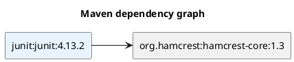
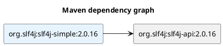
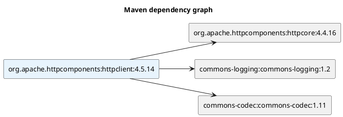

# Этап 5. Визуализация

Дата коммита: **08.11.2026, 23:41:00 +03:00**.

## Результаты

- `to_plantuml` создаёт текст диаграммы со всеми вершинами и рёбрами.
- Для каждого пакета назначается отдельный безопасный идентификатор.
- Корневой пакет выделяется цветом, циклические рёбра сохраняются.
- UTF-8 текст кодируется raw-deflate и алфавитом PlantUML средствами Python.
- Ответ PlantUML-сервера проверяется как SVG/XML и сохраняется в `output/`.
- При `open_image=true` локальное SVG открывается через системный браузер.
- При `ascii_tree=true` дерево выводится в терминал.

Исходный `.puml` записывается до обращения к серверу. Поэтому он остаётся
доступен и при ошибке сети. С `render=false` рендеринг можно отключить
и выполнять анализ тестового репозитория полностью автономно.

Изображения и прочие результаты в `output/` не входят в Git.
После клонирования они воспроизводятся приведёнными ниже командами.

## Пример 1. JUnit 4.13.2

```console
py -3 run.py --config examples/maven/junit.ini
```

```text
junit:junit:4.13.2
\-- org.hamcrest:hamcrest-core:1.3
```



Файлы: `output/junit_junit_4.13.2.puml` и
`output/junit_junit_4.13.2.svg`. Две вершины, одно ребро.

## Пример 2. SLF4J Simple 2.0.16

```console
py -3 run.py --config examples/maven/slf4j.ini
```

```text
org.slf4j:slf4j-simple:2.0.16
\-- org.slf4j:slf4j-api:2.0.16
```



Файлы: `output/org.slf4j_slf4j-simple_2.0.16.puml` и
`output/org.slf4j_slf4j-simple_2.0.16.svg`. Две вершины, одно ребро.

## Пример 3. Apache HttpClient 4.5.14

```console
py -3 run.py --config examples/maven/httpclient.ini
```

```text
org.apache.httpcomponents:httpclient:4.5.14
+-- org.apache.httpcomponents:httpcore:4.4.16
+-- commons-logging:commons-logging:1.2
\-- commons-codec:commons-codec:1.11
```



Файлы: `output/org.apache.httpcomponents_httpclient_4.5.14.puml` и
`output/org.apache.httpcomponents_httpclient_4.5.14.svg`.
Четыре вершины, три ребра.

## Общие зависимости и циклы

```console
py -3 run.py --config examples/test/diamond.ini
```

```text
A
+-- B
|   \-- D
\-- C
    \-- D [shared]
```

```console
py -3 run.py --config examples/test/cycle.ini
```

```text
A
\-- B
    \-- C
        +-- A [cycle]
        \-- D
```

`[shared]` — ссылка на уже раскрытую общую зависимость,
`[cycle]` — ссылка на вершину текущего пути. Эти случаи не смешиваются.
Обратные графы визуализируются тем же способом; в их PlantUML
добавляется подпись направления, а к имени файла — `-reverse`.

## Проверка и сравнение

Три SVG фактически получены от PlantUML-сервера. Их XML-подписи,
идентификаторы вершин и направленные рёбра проверяются командой:

```console
py -3 tools/verify_examples.py
```

Функция открытия изображения проверена с mock системного вызова;
графический интерфейс при автоматических проверках не запускался.
Для обычного запуска с показом изображения в `config.ini` установлены
`render=true` и `open_image=true`.

Фактический вывод штатного Maven и сравнение трёх пакетов сохранены
в [отчёте сравнения](comparison.md).
